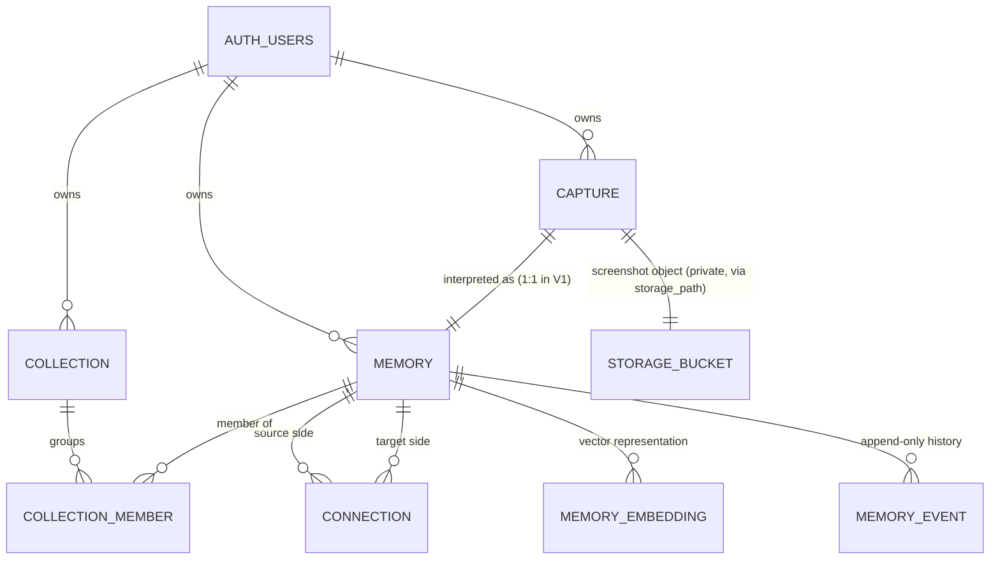

# Phase 2 — Data & Memory Architecture: ScreenView

| | |
|---|---|
| **Project** | ScreenView |
| **Phase** | 2 — Data & Memory Architecture |
| **Status** | ✅ Complete |
| **Date** | 2026-09-28 |
| **Next phase** | Phase 3 — AI Architecture |

This document translates the Phase 1 product definition into a practical data architecture: how ScreenView **represents, stores, retrieves, connects, and updates** memories. Per the Phase 2 brief, the existing repository was inspected before any design work; no schema existed, so this is a greenfield design. **Nothing in this document has been executed** — no Supabase changes, no migrations, no DDL. The reference DDL in Appendix A is documentation for the build phase, not an implementation.

## 1. Current schema inspection

Inspected on 2026-09-28, before designing anything:

- Repository structure — full recursive file tree (excluding `.git/`)
- Git history — 2 commits, 5 tracked files
- Full contents of `README.md`, `PROJECT_PLAN.md`, `docs/README.md`, `docs/phase-1-product-definition.md`
- Full-text search across all tracked files for: `Supabase`, `schema`, `SQL`, `migrations`, `captures`, `memories`, `connections`, `collections`, `intent`, `embeddings`, `pgvector`

**Findings:**

| Signal | Result |
|---|---|
| Database schema (tables / DDL) | ❌ None — no `.sql` files, no `supabase/` directory, no `migrations/` |
| Supabase configuration | ❌ None — no env files, no client code, no project reference in the repo |
| Application code | ❌ None — the repository is documentation-only (by design, per Phase 1) |
| Mentions of Supabase / pgvector / migrations | Only as **technology-direction candidates** in `PROJECT_PLAN.md` (technology table) and `README.md` (architecture direction); conceptual mentions of memories/collections/intent in the Phase 1 document |

**Conclusion:** there is no existing schema to preserve, evaluate, or migrate, and no Supabase project is referenced anywhere in the repository. Per the brief, no external Supabase changes were made (or attempted). What follows is the **initial** schema proposal, to be created through forward-only migrations when the build phase begins. The database-change rule is satisfied trivially: nothing was discarded and nothing destructive was done (see §15).

## 2. Data model overview

### 2.1 Design principles

1. **Immutability where it matters** — the capture (original screenshot + verbatim note) never changes; history is append-only.
2. **Current state + history** — each memory carries denormalized *current* values for fast reads; every change is also an immutable event.
3. **Suggestions vs facts** — everything the AI proposes (connections, collections, memberships) carries a state and evidence; it never silently becomes a user fact.
4. **Provenance everywhere** — who or what asserted a value (user vs AI, via which signal), with confidence and timestamp.
5. **Minimal by default** — no speculative fields; vocabularies are small text `CHECK` constraints that are cheap to evolve.
6. **RLS-ready** — every table carries `user_id` so Row Level Security can be enabled from day one, even though V1 is single-user.

### 2.2 Entities (7 tables + storage)

| Table | Represents | Notes |
|---|---|---|
| `captures` | What the user submitted (original screenshot + verbatim note) | 1 per upload; immutable |
| `memories` | The system's current understanding of a capture | 1:1 with `captures` in V1 |
| `memory_events` | Append-only history of intent/status/action/topic changes | N per memory |
| `connections` | Meaningful relationships between two memories | N:N, undirected in V1, with states |
| `collections` | Dynamic groups emerging from memories and connections | With origin + states |
| `collection_members` | Which memories belong to which collections | N:N join, with states |
| `memory_embeddings` | Vector representations of memories | N per memory (one per model) |
| Supabase Storage (private bucket) | Screenshot files | Referenced by `captures.storage_path` |

### 2.3 Concept separation (per the Phase 2 brief)

| Concept | Where it lives |
|---|---|
| **CAPTURE** — what was submitted | `captures` row + storage object |
| **MEMORY** — what the system understands | `memories` row |
| **INTENT** — why it was saved | `memories.current_intent` + `memory_events` history |
| **TOPIC** — what it is about | `memories.topic` + events on change |
| **ACTION** — what the user may want to do | `memories.suggested_action` + events |
| **STATUS** — where it currently stands | `memories.status` + events |
| **CONNECTION** — how it relates to another memory | `connections` row |
| **COLLECTION** — higher-level emerging group | `collections` + `collection_members` |

No concept is collapsed into another, and no core concept is buried in a generic JSON field. (`basis` JSONB columns store *evidence for AI suggestions*, not concept data — see §6/§7.)

### 2.4 Core access patterns

- **Capture flow (write):** insert `captures` (`pending`) → upload to Storage → processing → insert `memories` + initial `memory_events` → upsert `memory_embeddings`.
- **Correction (write):** one transaction = append a `memory_events` row (actor `user`) + update the denormalized current value on `memories`.
- **Retrieval (read):** SQL filters (status, action, topic, date); vector similarity (`memory_embeddings`, pgvector cosine KNN); graph traversal (`connections`); collection membership joins.
- **PA reads (Phase 5):** stalled intents, actionable items, aging memories — all derivable from `memories` + `memory_events` timestamps.

## 3. Capture model

| Field | Type (reference) | Notes |
|---|---|---|
| `id` | uuid PK | |
| `user_id` | uuid FK → `auth.users` | Ownership; enables RLS |
| `storage_path` | text | Private-bucket object path; convention `captures/{user_id}/{capture_id}.{ext}` |
| `original_note` | text, nullable | **Verbatim and immutable** — the user's *why*; never overwritten by AI |
| `source` | text, nullable | Device/origin hint (`phone`, `laptop`, `web`) |
| `mime_type` | text | Image type |
| `file_hash` | text | sha-256 of the original file; exact-duplicate signal; indexed per user, **not unique** |
| `processing_status` | text + CHECK | `pending` → `processing` → `completed` \| `failed` |
| `created_at` | timestamptz | Capture time |

Invariants:

- `original_note` is stored exactly as typed. AI interpretation lives on the memory side, never on the capture.
- Screenshots live in a **private** storage bucket (see §13).
- `file_hash` is indexed but **not** unique: exact duplicates are *detected*, not blocked — the product decides what to do with them (see §12).
- `processing_status = failed` leaves no memory row; retries are always possible.

## 4. Memory model

| Field | Type (reference) | Notes |
|---|---|---|
| `id` | uuid PK | |
| `user_id` | uuid FK | RLS |
| `capture_id` | uuid FK, **unique** | 1:1 with capture in V1 |
| `title` | text | Short human-readable label |
| `summary` | text | Condensed content of the capture |
| `visual_description` | text, nullable | What is visible; feeds the canonical embedding input |
| `topic` | text, nullable | Free text — "what is this about?"; AI-suggested, user-correctable |
| `current_intent` | text + CHECK | "Why saved" — current value; `'unknown'` allowed |
| `intent_source` | text + CHECK | Provenance, per the Phase 1 hierarchy |
| `intent_confidence` | real 0–1 | Confidence of the current intent |
| `suggested_action` | text + CHECK | "What next" — a suggestion by definition; user-confirmable |
| `status` | text + CHECK | Lifecycle: `new` · `active` · `completed` · `dismissed` · `archived` |
| `created_at` / `updated_at` | timestamptz | |

Design notes:

- A memory row is created **only after successful interpretation**, so `title` and `summary` can be non-null.
- Current values are denormalized from the latest events (fast reads); the events table is the source of truth for history.
- **Deliberate omissions (minimality):** no overall `confidence` column (confidence is per-assertion and lives on events; `intent_confidence` is the one worth denormalizing); no `tags` array (topics, intents, and collections cover V1 — tags would re-introduce manual organization).

## 5. Intent history model

All intent assertions are rows in `memory_events` with `event_type = 'intent_change'`; the initial assertion has `old_value = NULL`. Each event records: `old_value` → `new_value`, `source` (provenance hierarchy), `actor` (`user` | `system`), `confidence`, `reason`, `created_at`.

Rules:

- **Append-only** — no updates, no deletes; intent is never destroyed.
- `memories.current_intent` / `intent_source` / `intent_confidence` are materializations of the latest event, updated in the same transaction.
- `'unknown'` is a first-class value — the system may honestly not know.
- A correction is simply a user-authored event (see §11).

Example (the brief's scenario):

| When | Event | old → new | source / actor | reason |
|---|---|---|---|---|
| Day 1 | `intent_change` | ∅ → `buy` | `user_statement` / user | Note: "I want to buy this." |
| Later | `intent_change` | `buy` → `research` | `user_statement` / user | Correction: "I was only researching this." |

The system preserves the fact that the original intent was `buy`, when it changed, who changed it, and why.

## 6. Connection model

- **Undirected in V1:** canonical ordering `source_memory_id < target_memory_id` (CHECK) + unique `(source, target, relationship_type)` — one row per pair per type, no A→B/B→A duplicates.
- **Relationship types (small, meaningful vocabulary):**
  - `same_subject` — two memories about the same thing (perfume A ↔ perfume B)
  - `complementary` — things that go together (laptop ↔ laptop accessory)
  - `thematic` — shared theme across topics (website ↔ website as "inspiration"; AI tool ↔ project idea)
  - `user_linked` — explicit user-created link
- **Meaningful, not merely similar:** a connection must be justified by more than cosine similarity. The `basis` JSONB records the signals (shared topic, same intent, complementary categories, visual similarity, temporal proximity…). Similarity may *propose*, but the relationship type must express *why* it matters — "similar" is deliberately not a relationship type. Scoring/thresholds are Phase 4 territory.
- **States:** `suggested` (AI-proposed) → `confirmed` (user-approved or user-created) → `dismissed` (rejected; kept as a learning signal, never hard-deleted).
- `origin`: `ai` | `user`; `confidence`: real.

## 7. Collection model

- `collections`: `name`, optional `description`, `origin` (`ai_suggested` | `user_created`), `state` (`suggested` | `accepted` | `dismissed` | `archived`), and `basis` — the evidence pattern that justified suggesting it (supports Phase 1's "only suggest when there is enough evidence" rule).
- `collection_members`: many-to-many join with its own `state` (`suggested` | `confirmed` | `dismissed`) + `confidence`, unique per (collection, memory).
- **Collections are not the primary organization:** every query works without them; memories never live "inside" collections — dismissing or deleting a collection loses nothing.
- Emergence: the AI suggests only when evidence accumulates (`basis` records it); the user accepts, renames, merges, or dismisses; user-created collections are first-class.

## 8. Action / status model

- Action and status are **attributes of a memory**, not standalone entities, in V1.
- Why not tables: in V1 they have no identity, metadata, or lifecycle of their own beyond the memory's. If actions later need their own data (due dates, links, completion receipts), they can be promoted to entities without changing what the current model *means*.
- Vocabularies (text + CHECK — evolvable with a single constraint change, no giant enums):
  - **action:** `buy` · `research` · `try` · `build` · `read` · `watch` · `save_for_later` · `compare` · `contact` · `reference` · `none`
  - **status:** `new` · `active` · `completed` · `dismissed` · `archived`
- History: every change is a `memory_events` row (`action_change`, `status_change`) preserving who/when/why — the Phase 1 §15 requirement.

## 9. Embedding / vector architecture

- **Where:** `memory_embeddings` — a separate table, not a column on `memories`.
  Rationale: embeddings are *derived* data; they must be re-generable without touching memories; they are model-versioned; and a memory may eventually carry more than one representation (text-only vs multimodal).
- **What it represents:** the **memory**, semantically — *not* raw OCR text.
- **Canonical embedding input** (final assembly decided in Phase 3): `title` + `summary` + `topic` + `current_intent` + `suggested_action` + `visual_description` + **original user note** (it carries the *why*); and, if the Phase 3 model is multimodal, the screenshot itself.
- **Metadata per row:** `model` (id/version), `input_hash` (hash of the exact canonical input — re-embed only when the input changes), `created_at`, `user_id` (RLS).
- **Search (pgvector):** enable the `vector` extension at build time; declare the column with the chosen model's dimensions; HNSW index with cosine ops; KNN via the `<=>` operator:

```sql
-- illustrative (build phase)
select m.id, m.title, e.embedding <=> :query_embedding as distance
from memory_embeddings e
join memories m on m.id = e.memory_id
where e.model = :model and m.user_id = auth.uid()
order by e.embedding <=> :query_embedding
limit 20;
```

- **Deliberately deferred to Phase 3:** embedding model, dimensions, exact canonical input assembly, and multimodal inclusion.

## 10. Memory lifecycle

```
Capture row created (processing_status = 'pending')
  ↓  screenshot → Supabase Storage (private); note stored verbatim
  ↓  processing_status = 'processing'
  ↓  AI interpretation (Phase 3 model calls)
  ↓  Memory row created + initial events (intent/status assertions, old_value = NULL)
  ↓  processing_status = 'completed'
  ↓  Embedding generated (memory_embeddings; canonical input hashed)
  ↓  Memory becomes searchable (SQL + pgvector)
  ↓  Connections discovered (rows, state = 'suggested')
  ↓  Collections potentially suggested (rows + members, state = 'suggested')
  ↓  User interacts / corrects / completes
  ↓  Memory updated (current_* columns) + memory_events appended
  ↓  History and signals preserved (append-only)
```

- **Failure path:** `processing_status = 'failed'` — no memory row; retry allowed.
- **Deletion path:** V1 prefers `status = 'archived'` over deletion; a hard delete cascades to the memory's events, embeddings, connections, and memberships.

## 11. User correction considerations

- A correction is a **user-authored `memory_events` row**: `old_value` (what the AI believed) → `new_value`, with `actor = 'user'`, a `source`, and a `reason` (e.g., "No, I just wanted to research it.").
- The current memory reflects the correction immediately (same-transaction denormalized update); the AI's prior belief is preserved for later learning.
- Phase 6 can mine "AI asserted X → user corrected to Y" patterns from history alone — **no separate corrections table is needed**, and nothing in this schema prevents the learning system.
- Dismissed AI suggestions (connections, collections, memberships) are state-changed, not deleted — negative signals survive.
- The original user note is never overwritten (§3); user corrections live on the memory/events side.

## 12. Duplicate considerations

| Level | Meaning | Where the signal lives (when implemented) |
|---|---|---|
| Exact duplicate | Identical file bytes | `captures.file_hash` (sha-256, indexed per user) — detectable from the first build |
| Near duplicate | Same image, minor differences (crop, resize, re-save) | Future perceptual hash (e.g., pHash) — a column on `captures`, or an `image_fingerprints` table if multiple hashes prove useful; embedding cosine as a secondary signal |
| Same subject, different screenshot | Two saves about the same thing | Semantic: `connections` row with `relationship_type = 'same_subject'`, state `suggested` |
| Genuinely different memory | Unrelated | No linkage (default) |

- Duplicates are **allowed at the data layer** (no unique constraint on `file_hash`) — the UX/policy decision (block, warn-and-confirm, link, or merge) is deliberately deferred; the schema supports any of them.
- Nothing in this phase implements detection; this section fixes only *where the information will live*.

## 13. Privacy / security considerations

- **User ownership:** every table carries `user_id`; all rows cascade-delete with the user — the data belongs to the user, and leaving is clean.
- **Row Level Security:** RLS is enabled on all tables with `using (auth.uid() = user_id)` policies (documented here; applied at build time). Even in single-user V1, this makes safety structural rather than conventional.
- **Storage:** screenshots live in a **private** Supabase Storage bucket (never public), under user-scoped paths (`captures/{user_id}/…`); the frontend views them via short-lived signed URLs.
- **API access:** the frontend talks to our backend API — or to Supabase directly with the user's JWT (the public anon key is acceptable only because RLS enforces ownership). The service-role key is **server-side only**.
- **Server-side secrets:** AI provider keys (Groq, etc.) live only as backend environment variables (Vercel) — never in frontend code, never in `NEXT_PUBLIC_*`, never committed. `.gitignore` already excludes `.env*`.
- **Sensitivity assumption:** screenshots and notes may contain private information — private-by-default storage, no third-party sharing, and provider data-handling/retention is a Phase 3 criterion for model choice.
- **Authentication** is not built in this phase (per the brief); the schema is auth-ready so it can be added later without disruptive migrations.

## 14. Relationship diagram



(`AUTH_USERS` = Supabase `auth.users`; `STORAGE_BUCKET` = Supabase Storage — referenced by path, not by foreign key.)

## 15. Recommended schema changes

**None — there is no existing schema to change.**

| CURRENT | PROBLEM | PROPOSED CHANGE | WHY |
|---|---|---|---|
| No tables exist (docs-only repository) | N/A | Adopt this document as the baseline **initial** schema; implement via forward-only migrations at build time (Phase 8, or earlier only if explicitly instructed) | The brief's change rule has nothing to act on; nothing was discarded, altered, or destroyed |

Constraints honored: no destructive migrations, no deleted tables or data, and no production Supabase tables created (none exist, and none were made).

## 16. Intentionally NOT implemented yet

- No SQL executed anywhere — no tables, indexes, triggers, or RLS policies created (Appendix A is reference documentation)
- No pgvector extension enabled; embedding dimensions not pinned (Phase 3 decides the model → dimensions)
- No embedding pipeline, canonical-input assembly, or vector search
- No Supabase project created, connected, or modified
- No authentication
- No upload functionality or storage buckets
- No Groq connection, no AI prompts, no interpretation logic
- No connection-discovery or collection-suggestion algorithms
- No duplicate detection
- No UI, no API routes

All of the above belong to Phase 3+; this phase only guarantees the data model will not *prevent* them.

---

## Appendix A — Reference DDL (documentation only — NOT executed)

```sql
-- ============================================================
-- ScreenView — initial schema (Phase 2 reference DDL)
-- Documentation only. To be implemented as forward-only
-- migrations in the build phase. Nothing here has been run.
-- ============================================================

-- Prerequisite (at build time): enable pgvector
-- create extension if not exists vector;

-- 1) CAPTURES — the original submission (immutable)
create table public.captures (
  id                uuid primary key default gen_random_uuid(),
  user_id           uuid not null references auth.users (id) on delete cascade,
  storage_path      text not null,                 -- Supabase Storage object path (private bucket)
  original_note     text,                          -- user's note, VERBATIM — never overwritten
  source            text,                          -- device/origin hint: 'phone' | 'laptop' | 'web' | ...
  mime_type         text not null default 'image/png',
  file_hash         text not null,                 -- sha-256 of the original file (exact-duplicate signal)
  processing_status text not null default 'pending'
                    check (processing_status in ('pending','processing','completed','failed')),
  created_at        timestamptz not null default now()
);
create index captures_user_created_idx  on public.captures (user_id, created_at desc);
create index captures_user_filehash_idx on public.captures (user_id, file_hash);  -- NOT unique: duplicates are detected, not blocked

-- 2) MEMORIES — the system's current understanding
create table public.memories (
  id                uuid primary key default gen_random_uuid(),
  user_id           uuid not null references auth.users (id) on delete cascade,
  capture_id        uuid not null unique references public.captures (id) on delete cascade,  -- 1:1 in V1
  title             text not null,
  summary           text not null,
  visual_description text,                         -- what is visible in the screenshot
  topic             text,                          -- free text, AI-suggested, user-correctable
  current_intent    text
                    check (current_intent in
                      ('buy','research','try','build','read','watch','save_for_later',
                       'compare','contact','inspiration','unknown')),
  intent_source     text
                    check (intent_source in
                      ('user_statement','strong_context','user_behavior',
                       'visual_inference','ai_inference','unknown')),
  intent_confidence real check (intent_confidence between 0 and 1),
  suggested_action  text
                    check (suggested_action in
                      ('buy','research','try','build','read','watch','save_for_later',
                       'compare','contact','reference','none')),
  status            text not null default 'new'
                    check (status in ('new','active','completed','dismissed','archived')),
  created_at        timestamptz not null default now(),
  updated_at        timestamptz not null default now()
);
create index memories_user_status_idx  on public.memories (user_id, status);
create index memories_user_created_idx on public.memories (user_id, created_at desc);

-- 3) MEMORY_EVENTS — append-only history (intent/status/action/topic)
--    old_value = NULL means the initial assertion.
create table public.memory_events (
  id          uuid primary key default gen_random_uuid(),
  user_id     uuid not null references auth.users (id) on delete cascade,
  memory_id   uuid not null references public.memories (id) on delete cascade,
  event_type  text not null check (event_type in
                ('intent_change','status_change','action_change','topic_change')),
  old_value   text,
  new_value   text not null,
  source      text not null check (source in
                ('user_statement','strong_context','user_behavior',
                 'visual_inference','ai_inference','system','unknown')),
  actor       text not null check (actor in ('user','system')),
  confidence  real,
  reason      text,                                -- evidence or the user's stated reason
  created_at  timestamptz not null default now()
);
create index memory_events_memory_idx on public.memory_events (memory_id, event_type, created_at desc);

-- 4) CONNECTIONS — meaningful relationships between memories (undirected in V1)
create table public.connections (
  id                uuid primary key default gen_random_uuid(),
  user_id           uuid not null references auth.users (id) on delete cascade,
  source_memory_id  uuid not null references public.memories (id) on delete cascade,
  target_memory_id  uuid not null references public.memories (id) on delete cascade,
  relationship_type text not null check (relationship_type in
                      ('same_subject','complementary','thematic','user_linked')),
  state             text not null default 'suggested'
                    check (state in ('suggested','confirmed','dismissed')),
  origin            text not null default 'ai' check (origin in ('ai','user')),
  confidence        real,
  basis             jsonb,                          -- signals justifying the connection (not raw similarity)
  created_at        timestamptz not null default now(),
  unique (source_memory_id, target_memory_id, relationship_type),
  check (source_memory_id < target_memory_id)       -- canonical ordering keeps the graph undirected
);
create index connections_user_state_idx on public.connections (user_id, state);
create index connections_target_idx     on public.connections (target_memory_id);

-- 5) COLLECTIONS — dynamic groups emerging from usage
create table public.collections (
  id          uuid primary key default gen_random_uuid(),
  user_id     uuid not null references auth.users (id) on delete cascade,
  name        text not null,
  description text,
  origin      text not null default 'ai_suggested' check (origin in ('ai_suggested','user_created')),
  state       text not null default 'suggested'
              check (state in ('suggested','accepted','dismissed','archived')),
  basis       jsonb,                                -- evidence pattern that justified the suggestion
  created_at  timestamptz not null default now(),
  updated_at  timestamptz not null default now(),
  unique (user_id, name)
);

-- 6) COLLECTION_MEMBERS — many-to-many with suggestion states
create table public.collection_members (
  id            uuid primary key default gen_random_uuid(),
  user_id       uuid not null references auth.users (id) on delete cascade,
  collection_id uuid not null references public.collections (id) on delete cascade,
  memory_id     uuid not null references public.memories (id) on delete cascade,
  state         text not null default 'suggested'
                check (state in ('suggested','confirmed','dismissed')),
  confidence    real,
  created_at    timestamptz not null default now(),
  unique (collection_id, memory_id)
);
create index collection_members_memory_idx on public.collection_members (memory_id);

-- 7) MEMORY_EMBEDDINGS — derived vectors (dimensions pinned when Phase 3 picks the model)
create table public.memory_embeddings (
  id          uuid primary key default gen_random_uuid(),
  user_id     uuid not null references auth.users (id) on delete cascade,
  memory_id   uuid not null references public.memories (id) on delete cascade,
  model       text not null,                        -- model id/version (decided in Phase 3)
  embedding   vector not null,                      -- dimensions declared at implementation time
  input_hash  text not null,                        -- hash of canonical input → re-embed only on change
  created_at  timestamptz not null default now(),
  unique (memory_id, model)
);
-- At build time (after Phase 3 fixes dimensions), e.g.:
-- create index memory_embeddings_hnsw_idx on public.memory_embeddings
--   using hnsw (embedding vector_cosine_ops);

-- Row Level Security (pattern — applied at build time, one per table):
-- alter table public.<table> enable row level security;
-- create policy "user owns <table> rows" on public.<table> for all
--   using (auth.uid() = user_id) with check (auth.uid() = user_id);
```

---

_Phase 2 complete — schema defined on paper, nothing executed. Next: Phase 3 — AI Architecture (awaiting go-ahead)._
